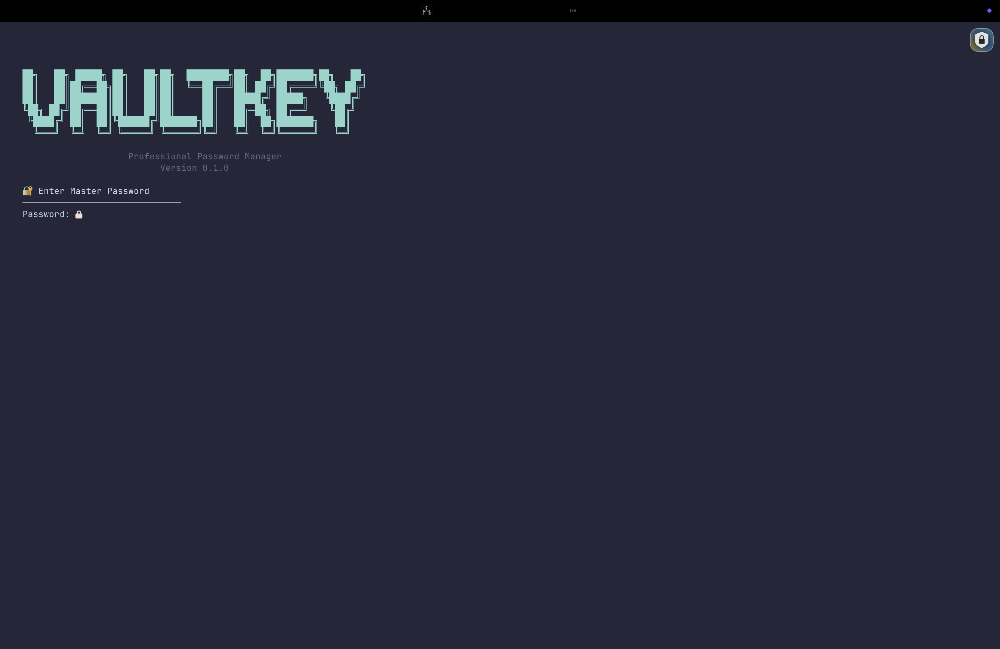
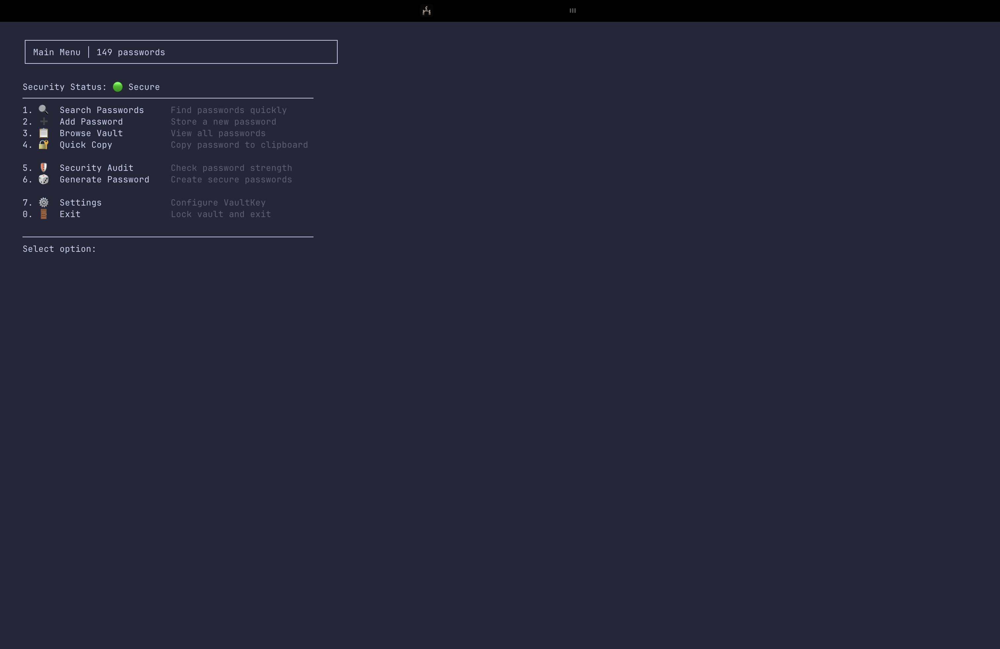
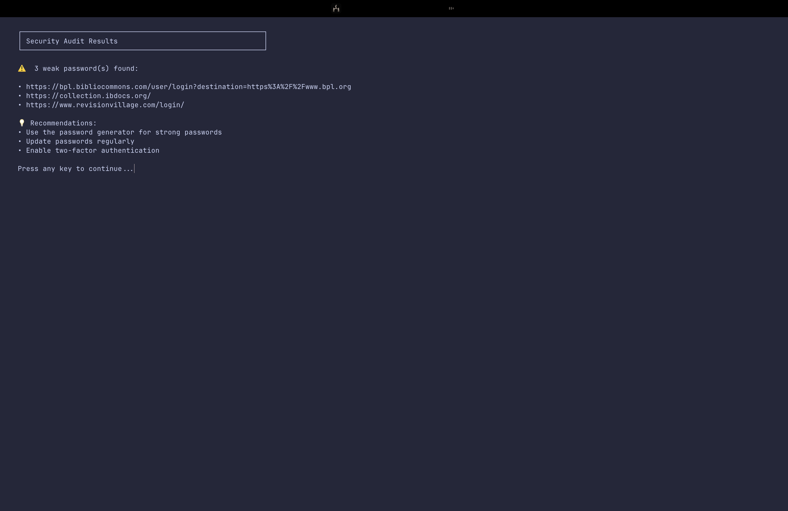

# VaultKey 🔐

[](https://github.com/dhruvkulkarni02/vaultkey/releases/latest)
[](https://github.com/dhruvkulkarni02/vaultkey/actions/workflows/tests.yml)
[](https://opensource.org/licenses/MIT)
[](https://www.python.org/downloads/)

**Local, offline password manager with Argon2id key derivation and AES-256-GCM encryption**

VaultKey keeps your passwords in a single encrypted file on your own machine and never sends them to any server. Your master password is never stored, and nothing in the vault file lets anyone check a guess faster than running Argon2id.

## ✨ What's New

The latest update is a security and reliability overhaul:

- **New vault format**: AES-256-GCM encryption with an Argon2id key. The salt and KDF settings live in the vault file's header, so there is no separate `salt.bin` to lose.
- **Fast offline guessing removed**: the old format stored a check value derived from a plain SHA-256 of the master password. Anyone with a copy of the vault could test guesses at SHA-256 speed and skip Argon2. That value is gone.
- **Automatic migration**: older vaults are converted the first time you unlock them. See [Upgrading from 1.0.x](#-upgrading-from-10x).
- **Crash-safe saves**: the vault is written to a temporary file and then swapped in. A crash or full disk can no longer corrupt it.
- **Self-contained backups**: `vk backup` writes one file that is all you need, and `vk restore` now works on a new machine with no vault yet.
- **Clipboard auto-clear that works**: `vk cp` and `vk get --copy` now clear the clipboard after the timeout, even though the command has already exited.
- **New `vk passwd` command** to change the master password, also available from interactive mode.
- **Smarter imports**: CSV columns are matched by header name, and several accounts for the same site are all kept.
- **Honest breach checks**: network errors are reported as errors, not as "no breaches found".
- **Test suite and CI**: 100+ tests run on Linux, macOS and Windows.

## 🚀 Features

- **🔒 Strong Encryption**: AES-256-GCM with a 256-bit key derived by Argon2id (64 MB memory cost)
- **🛡️ Local Only**: Your passwords never leave your device
- **✅ Tamper Detection**: Authenticated encryption detects any modification of the vault
- **💥 Crash-Safe Writes**: The vault is replaced atomically, so it is never half-written
- **💾 Secure Backups**: Single-file encrypted backups with their own password
- **📋 Secure Clipboard**: Copied passwords are cleared after a timeout, and your previous clipboard content is restored
- **🔍 Breach Detection**: Check passwords against known data breaches (HaveIBeenPwned, k-anonymity)
- **📊 Security Auditing**: Strength scoring, reused and old password detection
- **🎲 Password Generator**: Guarantees every selected character type appears
- **📁 Import/Export**: CSV, JSON, LastPass, Bitwarden, 1Password, Chrome/Edge and KeePass
- **🎯 Interactive Mode**: Menu-driven terminal interface

## 📸 Screenshots

### Interactive Mode


### Password List


### Security Audit


## 📦 Installation

### macOS, Linux, Windows: pip (recommended)
```bash
pip install "vaultkey-cli @ https://github.com/dhruvkulkarni02/vaultkey/releases/download/v2.0.0/vaultkey_cli-2.0.0-py3-none-any.whl"
```

Or install the latest source:

```bash
pip install git+https://github.com/dhruvkulkarni02/vaultkey.git
```

Both need Python 3.9+, and install the `vaultkey` and `vk` commands. You can also run `python -m vaultkey`. On macOS, [pipx](https://pipx.pypa.io/) keeps VaultKey in its own environment: `pipx install` followed by the same URL.

### Windows: standalone executable
Download `VaultKey-Windows.zip` from the [latest release](https://github.com/dhruvkulkarni02/vaultkey/releases/latest), unzip it and run `VaultKey.bat`. Python is not required. The executable isn't code-signed, so SmartScreen may ask you to confirm the first time (**More info → Run anyway**).

### macOS: standalone executable (Apple Silicon)
Download `VaultKey-Mac.zip` from the [latest release](https://github.com/dhruvkulkarni02/vaultkey/releases/latest) and unzip it. The app isn't signed by Apple, so macOS blocks it the first time. Either right-click `VaultKey.command` and choose **Open**, or clear the download flag in Terminal:

```bash
xattr -dr com.apple.quarantine ~/Downloads/VaultKey-Mac
```

## 🚀 Quick Start

```bash
# Create your vault (first time only)
vk init

# Add a password (VaultKey generates a strong one)
vk add -s github.com -u developer@email.com -g

# Copy it to the clipboard; it is cleared after 30 seconds
vk cp github

# Make a backup and keep it somewhere safe
vk backup -o ~/vaultkey-backup.vkbak
```

## 📖 Usage Examples

### Basic Password Management
```bash
# Add passwords
vk add -s github.com -u developer@email.com -g    # Generate password
vk add -s gmail.com -u myemail@gmail.com          # Enter manually

# Retrieve passwords
vk get -s github --show                           # Show password
vk get -s gmail --copy                            # Copy to clipboard
vk cp github                                      # Quick copy to clipboard
vk cp github -t 10                                # Clear the clipboard after 10 seconds

# Search passwords
vk search github                                  # Search site, username and notes
vk search --type weak                             # Find weak passwords (query is optional)
vk search --type old                              # Passwords older than 90 days

# List all passwords
vk list                                           # Basic list
vk list -f git                                    # Filter by 'git'
vk list -v                                        # Verbose with details
vk list --weak-only                               # Show only weak passwords

# Delete passwords
vk delete github.com                              # Delete with confirmation
vk delete github.com -f                           # Skip the confirmation
```

### Master Password and Backups
```bash
vk passwd                                         # Change the master password
vk backup                                         # Back up (asks for a backup password)
vk backup -o ~/vault.vkbak                        # Back up to a specific file
vk restore ~/vault.vkbak                          # Restore, also onto a new machine
```

When you restore onto a machine with no vault, VaultKey asks for a master password for the restored vault. When a vault exists, the restored data keeps its current master password. Backups keep the password they were made with, even after you run `vk passwd`.

> Prefer typing backup passwords at the prompt. The `-p/--password` option is supported for scripts, but it leaves the password in your shell history.

### Security Features
```bash
# Security audit
vk audit                                          # Basic strength audit
vk audit -v                                       # Verbose with details
vk audit -b                                       # Include breach checking
vk audit -w                                       # Show only weak passwords
vk audit -o                                       # Show only old passwords

# Check for breached passwords
vk breaches                                       # Check all passwords
vk breaches -s github.com                         # Check a specific site
vk breaches -v                                    # Verbose breach details

# Password generation
vk generate                                       # 16 characters, all types
vk generate -l 24                                 # 24 characters
vk generate --no-symbols                          # No special characters
vk generate --no-ambiguous                        # Avoid look-alikes: 0 O 1 l I | `
vk generate -c 5                                  # Generate 5 passwords
```

Breach checks send only the first 5 characters of each password's SHA-1 hash, and request padded responses so that response size reveals nothing either. If the service can't be reached, VaultKey says so instead of reporting your passwords as clean.

### Import and Export
```bash
vk import-passwords ~/passwords.csv                         # Generic CSV (default)
vk import-passwords ~/chrome.csv --format chrome
vk import-passwords ~/lastpass.csv --format lastpass
vk import-passwords ~/backup.json --format json             # VaultKey JSON export

vk export-passwords --format csv                            # Passwords hidden
vk export-passwords --format json -o export.json --include-passwords
```

- **Formats:** `csv`, `json`, `lastpass`, `bitwarden`, `1password`, `chrome`, `keepass`.
- **Generic CSV:** if the file has a header row, columns are matched by name in any order (`name`/`title`/`url`, `username`/`login`/`email`, `password`, `notes`). Without a header, the columns must be `site,username,password[,notes]`.
- **Duplicates:** several accounts for one site are all kept, as `Gmail`, `Gmail (bob)`, and so on. An import is saved in one step, and entries that already exist in your vault are skipped.
- **Exports:** files are created readable by you only (mode 0600). Passwords are left out unless you pass `--include-passwords`. Delete plaintext exports as soon as you're done with them.

### Interactive Mode
```bash
vk interactive
```

A menu for searching, adding, browsing, copying, auditing and generating passwords. Settings includes changing the master password and vault statistics.

## 📂 Where Your Data Lives

| What | Location |
|------|----------|
| Vault | `~/.vaultkey/passwords.encrypted` |
| Custom vault | Set `VAULTKEY_VAULT=/path/to/vault` |
| Backups | Where you choose with `-o`; by default `vaultkey_backup_<timestamp>.vkbak` in the current directory |

The vault is a single file. Copying it, together with your master password, is enough to open it anywhere.

## 🔒 Security Overview

- **Key derivation**: Argon2id with 3 iterations, 64 MB of memory and 4 lanes, and a random 32-byte salt per vault
- **Encryption**: AES-256-GCM with a fresh random nonce on every save
- **Self-describing header**: the KDF settings and salt are stored in the vault and authenticated with the ciphertext, so changing them is detected. Absurd settings in a crafted file are rejected before any work is done.
- **Nothing to check guesses against**: the only way to test a master password is to run Argon2id and attempt decryption
- **Atomic, private files**: the vault and backups are written to a temporary file with mode 0600, flushed to disk, and renamed into place
- **Clipboard**: clearing is handed to a small background process, which receives only a keyed fingerprint of the password, never the password itself
- **Lockout**: in interactive mode, 5 wrong passwords lock you out for 5 minutes. This is a convenience; offline guessing is limited by the cost of Argon2id.

### File format

```
VAULTKEY_V3:  |  header length (2 bytes)  |  header (JSON: kdf, kdf_params, salt, cipher)  |  nonce (12 bytes)  |  ciphertext + tag
```

Backups and encrypted exports use the same envelope.

## ⬆️ Upgrading from 1.0.x

- **Vaults** created by VaultKey 1.0.x are converted to the new format the first time you unlock them. After that, `salt.bin` is no longer needed.
- **Backups** (`.vkbak` with a `.salt` file next to them) and **encrypted exports** from 1.0.x can still be restored and imported.
- **Change your master password** with `vk passwd` after upgrading if old copies of your vault file might exist, for example in Time Machine, a synced folder or an old backup. Those copies still contain the 1.0.x check value that allows fast offline guessing.
- If `salt.bin` is missing for a 1.0.x vault, VaultKey tells you which file it needs, instead of reporting a wrong password.

## 📚 Command Reference

### Core Commands
| Command | Description |
|---------|-------------|
| `vk init` | Create a new password vault |
| `vk add` | Add a new password entry |
| `vk get` | Retrieve a password by site name |
| `vk list` | Display all stored passwords |
| `vk search` | Search by site, username or notes, optionally filtered by type |
| `vk cp` | Copy a password to the clipboard without showing it |
| `vk delete` | Remove a password entry |
| `vk passwd` | Change the master password |

### Security Commands
| Command | Description |
|---------|-------------|
| `vk audit` | Security audit: strength, age, reuse, optional breach check |
| `vk breaches` | Check passwords against the breach database |
| `vk generate` | Generate secure passwords without saving them |

### Data Management
| Command | Description |
|---------|-------------|
| `vk import-passwords` | Import from other password managers |
| `vk export-passwords` | Export passwords to a file |
| `vk backup` | Create an encrypted backup file |
| `vk restore` | Restore the vault from a backup |
| `vk interactive` | Launch interactive mode |
| `vk version` | Show version information |

## 🐍 Python API

```python
from vaultkey import PasswordManager, generate_password
from vaultkey.errors import VaultError

# Uses ~/.vaultkey/passwords.encrypted (or $VAULTKEY_VAULT) by default
pm = PasswordManager()

if not pm.unlock("your-master-password"):
    raise SystemExit("Wrong master password")

# Add a password
pm.add_password("github.com", "username", "password123")

# Generate and store a secure password
pm.add_password("example.com", "user@example.com", generate_password(length=20))

# Retrieve a password
creds = pm.get_password("github.com")
print(f"Username: {creds['username']}")

# Back up and change the master password
pm.create_secure_backup("backup-password", "vault.vkbak")
pm.change_master_password("your-master-password", "new-master-password")
```

`unlock()` returns `False` for a wrong password. Other problems raise subclasses of `vaultkey.errors.VaultError`:

- `LockoutError`
- `VaultNotFoundError`
- `VaultFormatError`
- `DecryptionError`
- `VaultLockedError`

## 📁 Project Structure

```
vaultkey/
├── vaultkey/
│   ├── __init__.py
│   ├── __main__.py        # python -m vaultkey
│   ├── cli.py             # Command-line interface
│   ├── manager.py         # Vault operations, migration, backup/restore
│   ├── crypto.py          # Argon2id + AES-256-GCM envelope, 1.0.x decryption
│   ├── storage.py         # Atomic, versioned file storage
│   ├── clipboard.py       # Copy with auto-clear via a background helper
│   ├── errors.py          # Exception types
│   ├── generator.py       # Password generation
│   ├── strength.py        # Password strength analysis
│   ├── breach.py          # Breach detection with HIBP
│   └── portability.py     # Import/export
├── tests/                 # pytest suite
├── .github/workflows/     # Tests, executable builds, release packages
├── pyproject.toml
├── requirements.txt
└── README.md
```

## 🛠️ Development

### Running Tests

```bash
pip install -e ".[dev]"
pytest
```

Tests run with low Argon2 settings so they finish in seconds. CI runs them on Ubuntu, macOS and Windows with Python 3.9, 3.12 and 3.13.

### Contributing

1. Fork the repository
2. Create a feature branch (`git checkout -b feature/amazing-feature`)
3. Add tests for your change and make sure `pytest` passes
4. Commit your changes (`git commit -m 'Add amazing feature'`)
5. Push to the branch (`git push origin feature/amazing-feature`)
6. Open a Pull Request

### Security Vulnerabilities

If you discover a security vulnerability, please report it privately (a GitHub security advisory or email to the maintainer) instead of opening a public issue.

## 🗺️ Roadmap

### Completed ✅
- [x] Argon2id key derivation with 64 MB memory cost
- [x] Authenticated AES-256-GCM encryption with a self-describing vault header
- [x] Automatic migration of 1.0.x vaults
- [x] Crash-safe, atomic vault writes
- [x] Self-contained backups and restore onto a new machine
- [x] Master password change (`vk passwd`)
- [x] Clipboard auto-clear that outlives the command
- [x] Password generation, strength analysis and breach detection
- [x] Import/export (CSV, JSON, LastPass, Bitwarden, 1Password, Chrome, KeePass)
- [x] Interactive mode
- [x] Test suite with cross-platform CI

### Planned 📋
- [ ] Session unlock (`vk unlock` / `vk lock`), so you don't type the master password for every command
- [ ] `vk edit`, `vk rename` and `vk history` commands
- [ ] Automatic rolling backups
- [ ] TOTP (2FA) codes
- [ ] Passphrases from a full diceware word list
- [ ] File locking against concurrent writers
- [ ] Desktop GUI and browser extension

## 📄 License

This project is licensed under the MIT License - see the [LICENSE](LICENSE) file for details.

## 🙏 Acknowledgments

- [cryptography](https://cryptography.io/) - Encryption library
- [argon2-cffi](https://argon2-cffi.readthedocs.io/) - Argon2 key derivation
- [HaveIBeenPwned](https://haveibeenpwned.com/) - Breach detection API
- [Click](https://click.palletsprojects.com/) - CLI framework
- [tabulate](https://pypi.org/project/tabulate/) - Table formatting

---

**⚠️ Security Notice**: VaultKey has not had an independent security audit. For mission-critical use, consider an established, audited password manager.

**🔑 Remember**: Use a strong master password and never share it with anyone. It cannot be recovered if you forget it.
